<h1 align="center">Doki Doki Photo Collage</h1>

<p align="center">
  Turn any background image into a reusable collage template, then fill it with your artwork or photos in a few clicks.<br>
  Windows desktop app (Python + Tkinter) &middot; exports PNG &middot; Instagram-aware sizing
</p>

<p align="center">
  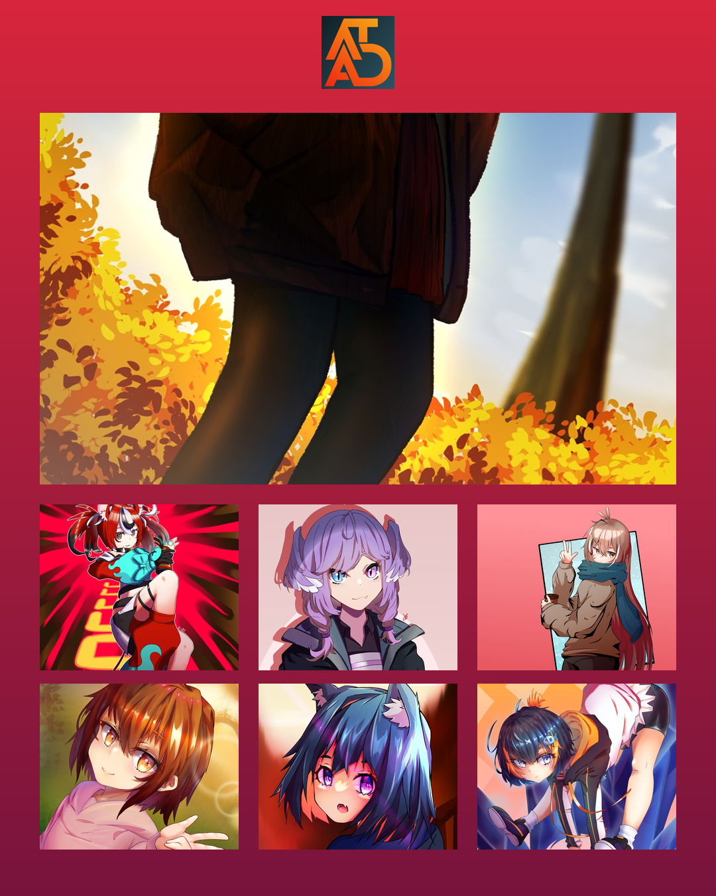
</p>

---

## Contents

1. [What it does](#what-it-does)
2. [Install and run](#install-and-run)
3. [Quick start: your first collage](#quick-start-your-first-collage) (5 steps)
4. [How the app flows](#how-the-app-flows)
5. [Guides](#guides)
   - [Reuse a saved template](#reuse-a-saved-template)
   - [Reuse past image folders](#reuse-past-image-folders)
   - [Split a placeholder into a grid](#split-a-placeholder-into-a-grid)
   - [Align, distribute and multi-select](#align-distribute-and-multi-select)
   - [Padding](#padding)
   - [Automatic image selection](#automatic-image-selection-random-gradient-colour-scheme)
   - [Adjust crops](#adjust-crops)
   - [Instagram size check](#instagram-size-check)
   - [Settings](#settings)
   - [Edit, rename and delete templates](#edit-rename-and-delete-templates)
6. [Editor cheat sheet](#editor-cheat-sheet)
7. [Where your data lives](#where-your-data-lives)
8. [Build the .exe](#build-the-exe)
9. [Tests](#tests)
10. [Troubleshooting](#troubleshooting)
11. [Repo layout and credits](#repo-layout-and-credits)

---

## What it does

A **template** is just an image (the background, frame or poster design). You draw **placeholders** (rectangles) on it where pictures should go and give each placeholder a **tag** such as `hero` or `grid`. Placeholders with the same tag draw their pictures from the same folder.

Once a template is saved you can reuse it forever: pick it, choose a folder for each tag, choose the images (by hand or automatically), fine-tune the crops and save a PNG.

Highlights:

- Draw, move, resize and snap placeholders; **split one into a rows x columns grid**.
- Tags map to image folders, so one collage can mix e.g. a hero illustration and a grid of portraits.
- **Remembers templates and recently used folders** so repeat collages take seconds.
- Manual picking, or **automatic** picking: random, colour gradient, or colour scheme (complementary, triadic...).
- Smart auto-crop (saliency based) with a drag/zoom crop editor.
- Instagram size check (1:1, 4:5, 1.91:1, 9:16) with one-click resize.

## Install and run

Requires **Python 3.10+** on Windows.

```powershell
pip install -e .[test]
python -m collage
```

The app has no command-line options; everything happens in the window. Prefer not to install Python? [Build the .exe](#build-the-exe) once and share the folder.

---

## Quick start: your first collage

### Step 1. Create a template

Start the app. The first screen lists saved templates (empty on first launch). Click **Create new...** and choose your background image (PNG or JPEG).

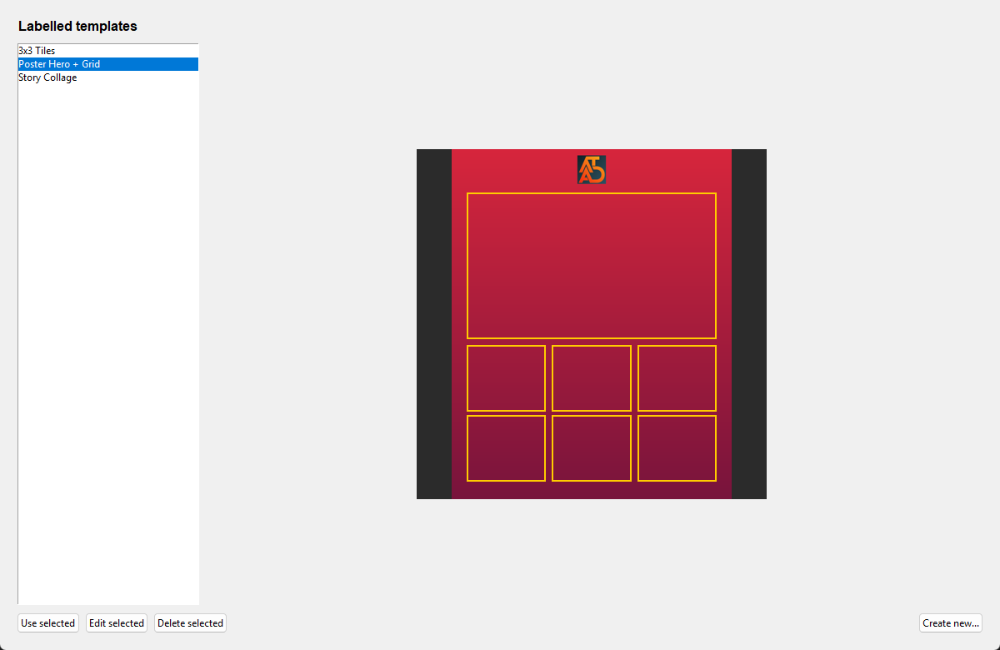

> Tip: for Instagram, make the background **1080 x 1350** (portrait) or **1080 x 1080** (square). Other sizes work too, see [Instagram size check](#instagram-size-check).

### Step 2. Draw placeholders

The editor opens with your image on the left and tools on the right.

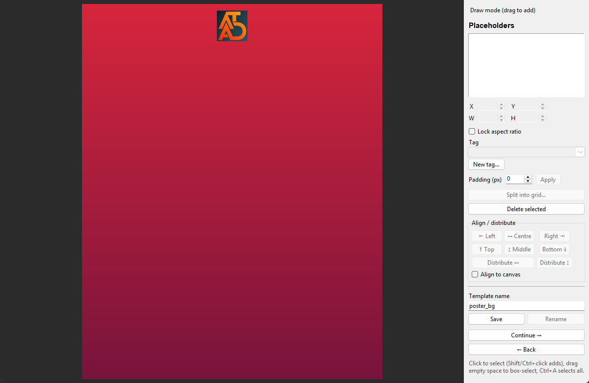

1. **Drag on empty space** to draw a rectangle (or tick **Draw mode** if dragging keeps moving things).
2. The first time, you are asked for a **tag name**. Type `hero`. Tags are free text; there are no built-in ones.
3. Draw a second, bigger rectangle for the lower area and give it a new tag with **New tag...**, e.g. `grid`.
4. Fine-tune with the handles (8 per placeholder), or type exact **X / Y / W / H** values in the side panel.

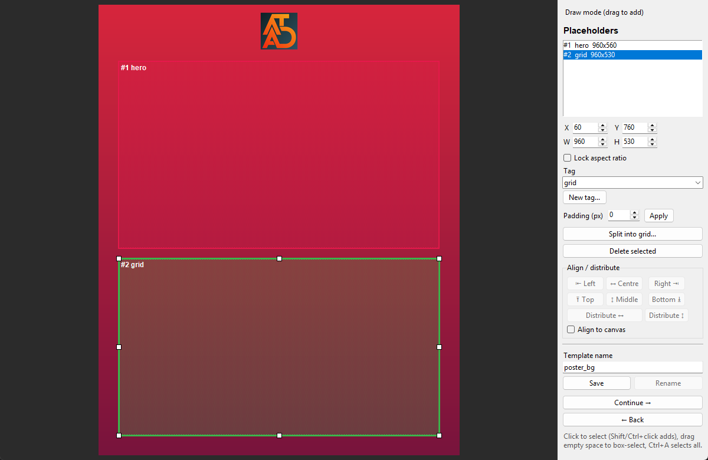

Placeholders snap to each other and to the canvas edges. Hold **Alt** to switch snapping off.

### Step 3. Split the grid area into cells (optional but handy)

Select the `grid` placeholder and click **Split into grid...**. Set **Rows = 2**, **Columns = 3**, **Gap = 30 px**. A live preview shows the cells before you commit.

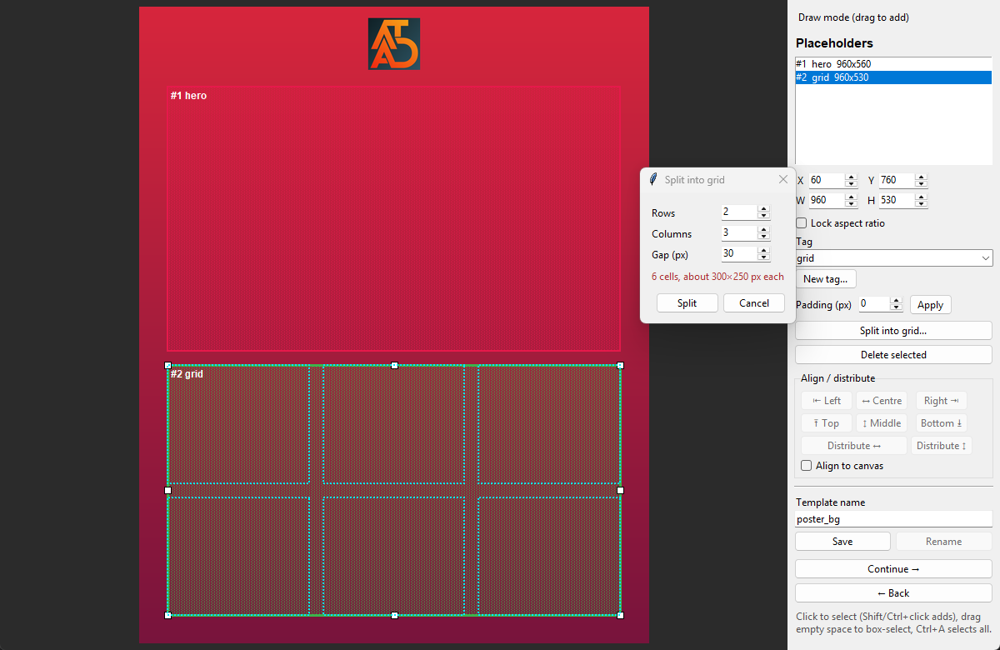

Click **Split**. The big rectangle is replaced by six placeholders that keep the same tag.

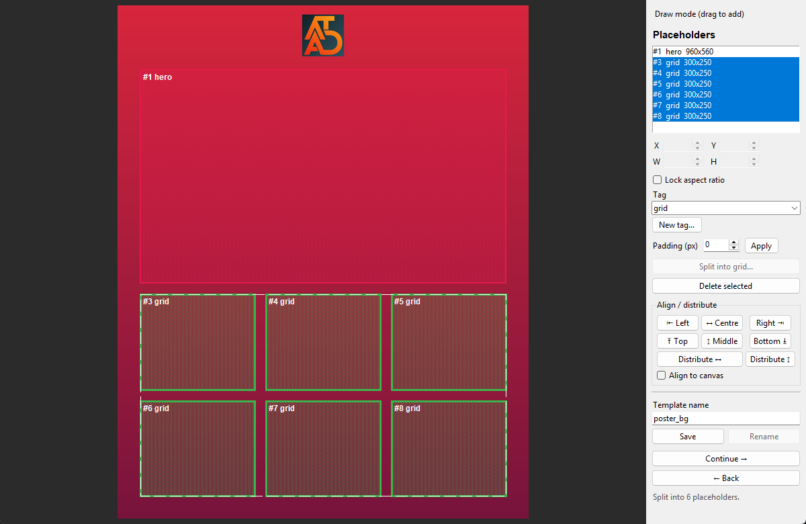

Give the template a name in **Template name** and click **Save**, then **Continue →**.

### Step 4. Choose an image folder for each tag

A wizard goes through your tags one at a time. The current tag's placeholders are highlighted on the preview.

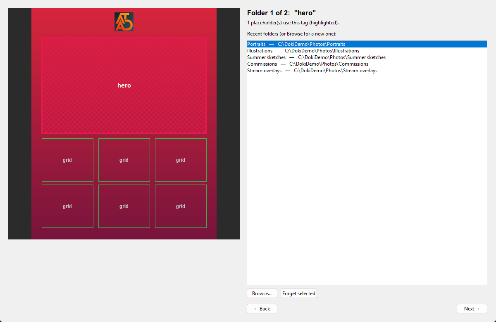

For each tag, select a folder from the **recent folders** list or click **Browse...** for a new one. Press **Next →**, repeat for `grid`, then **Finish**. The same folder can be used for several tags.

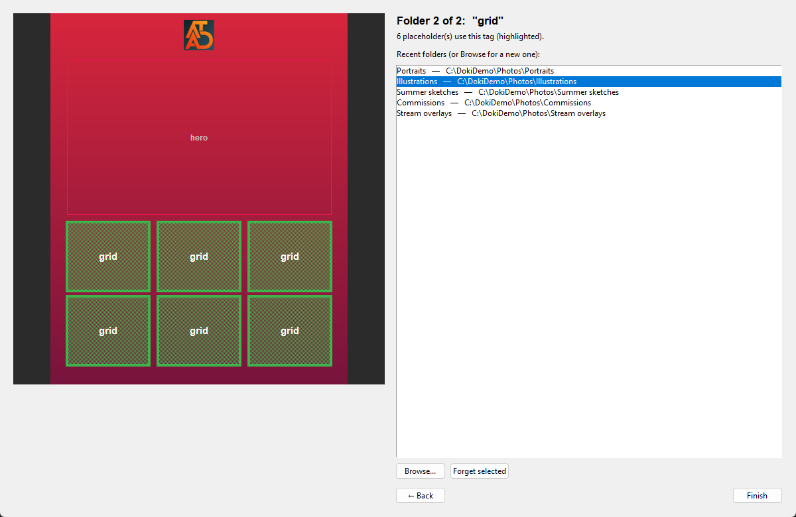

### Step 5. Pick the images and save the collage

You land on **Image selection**. In **Manual** mode there is one tab per tag, labelled with progress, e.g. `grid (6/6)`. Click thumbnails to choose; numbers show the order in which they fill the placeholders.

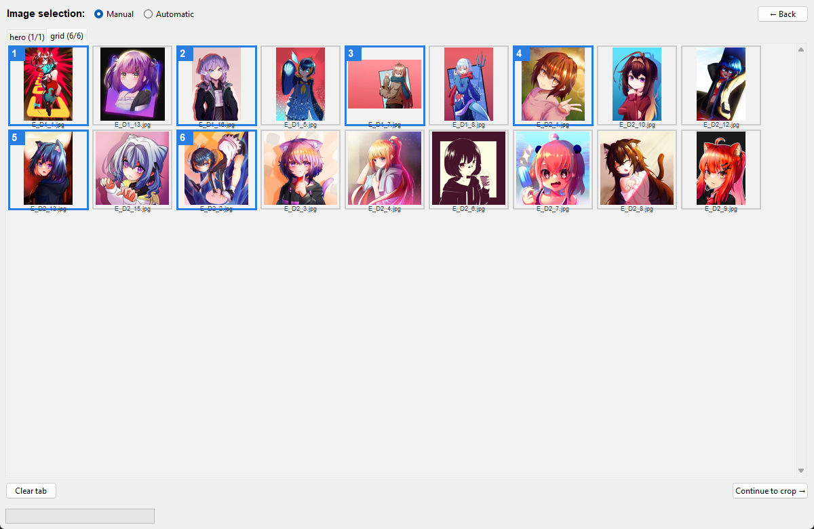

When every tab is complete, **Continue to crop →** becomes active. Crops are computed automatically and shown on a live preview. Check them, adjust any you dislike (see [Adjust crops](#adjust-crops)), then click **Save PNG**.

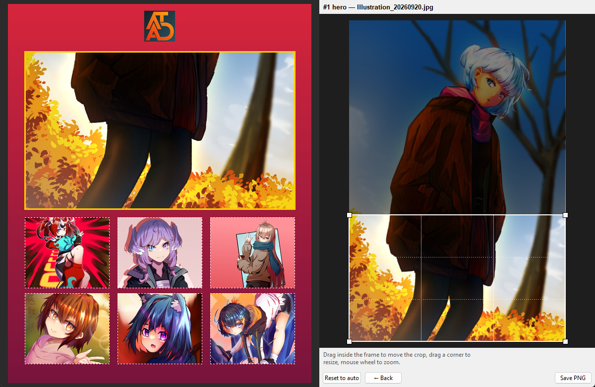

That is it. Your template is saved, so next time you only need steps 4 and 5.

---

## How the app flows

```
Template picker ──► Editor ──► Folder wizard ──► Size check ──► Image selection ──► Crop editor ──► Save PNG
   (File > Templates)  (draw & tag)  (one folder per tag)   (Instagram)    (manual / automatic)   (fine-tune)
        │                                  ▲
        └── Use selected ──────────────────┘   (skips the editor for saved templates)
```

| Screen | What you do | Back goes to |
|---|---|---|
| **Templates** | Use, edit, delete or create a template | n/a |
| **Editor** | Draw, tag, split and align placeholders; save | Templates |
| **Folder wizard** | Choose an image folder for every tag | Previous tag, then Templates / Editor |
| **Size check** | Optional prompt if the template is not an Instagram size | Editor |
| **Image selection** | Pick images manually or automatically | Editor |
| **Crop editor** | Adjust crops, then save | Image selection |

---

## Guides

### Reuse a saved template

Open the app (or **File → Templates** at any time). Every saved template is listed with a preview of its placeholders.


| Button | Does |
|---|---|
| **Use selected** (or double-click) | Skips the editor and goes straight to the folder wizard |
| **Edit selected** | Opens the editor to change placeholders |
| **Delete selected** | Removes the template (asks first) |
| **Create new...** | Starts a new template from an image |

Templates keep their own copy of the background image, so moving or deleting your original file does not break them. If a template's image ever goes missing, the app offers to locate it again.

### Reuse past image folders

Folders you have used are remembered, most recent first, and listed in the folder wizard.

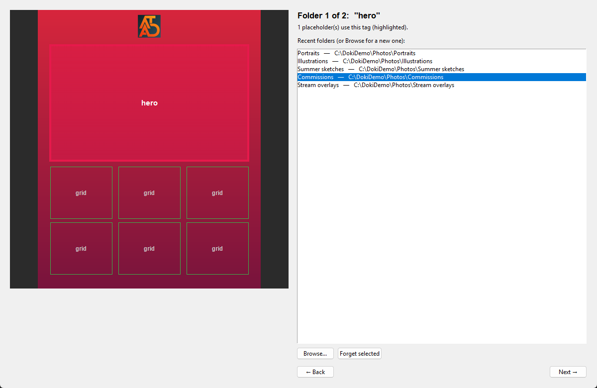

- **Single-click + Next →** or **double-click** a folder to take it and move on.
- **Browse...** adds a new folder and selects it.
- **Forget selected** removes a folder from the list (the folder itself is not touched).
- Folders that no longer exist are marked `[missing]`.
- Change how many are remembered (1 to 50, default 10) or clear the list in [Settings](#settings).

### Split a placeholder into a grid

Faster than drawing many equal rectangles.

1. Draw one rectangle covering the whole grid area and give it a tag.
2. Select it (only one placeholder can be split at a time) and click **Split into grid...**.
3. Enter **Rows**, **Columns** and **Gap (px)**. The dialog shows how many cells result and their approximate size.
4. Click **Split**. If it would create more than 36 placeholders you are asked to confirm.

The new cells inherit the **tag** and **padding** of the original, and all of them end up selected so you can immediately align or re-tag them.


### Align, distribute and multi-select

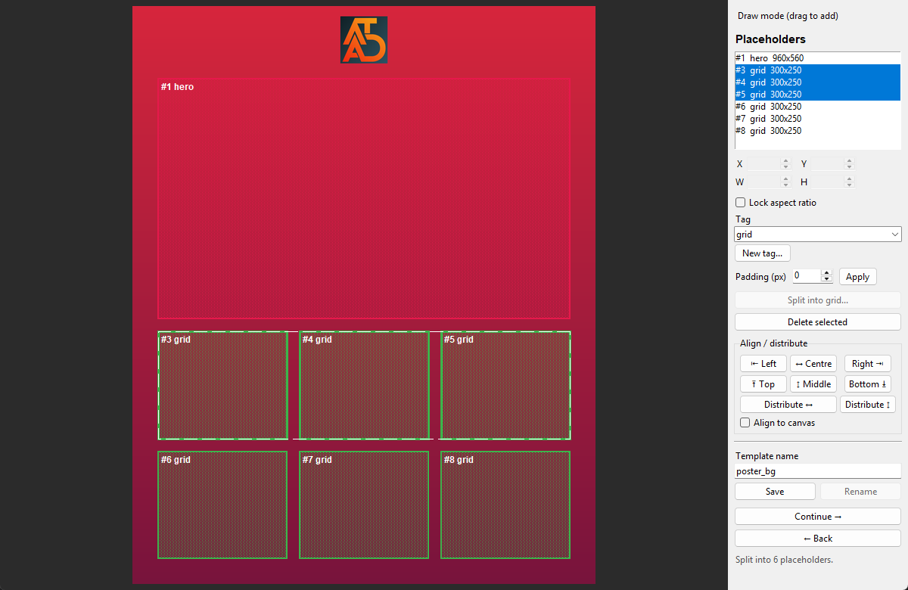

- **Select several:** Shift/Ctrl + click, drag a box on empty space, pick several rows in the *Placeholders* list, or press **Ctrl+A**.
- Selected placeholders **move and snap together** as a group.
- **Align / distribute** panel: Left, Centre, Right, Top, Middle, Bottom. They align to the selection by default; tick **Align to canvas** to align to the template edges instead.
- **Distribute ↔ / ↕** spaces items evenly and needs 3 or more selected.
- **Draw new placeholders while others are selected:** turn on **Draw mode**, or hold **Ctrl** while dragging.
- **Delete** key (or **Delete selected**) removes the selection.
- Changing the **Tag** dropdown re-tags every selected placeholder.

### Padding

**Padding (px)** insets the picture inside its placeholder, so the template background shows as a margin or frame. Type a value and click **Apply** (applies to the selection). Set a default for new placeholders in [Settings](#settings).

### Automatic image selection (random, gradient, colour scheme)

On the *Image selection* screen switch **Image selection** from **Manual** to **Automatic**.

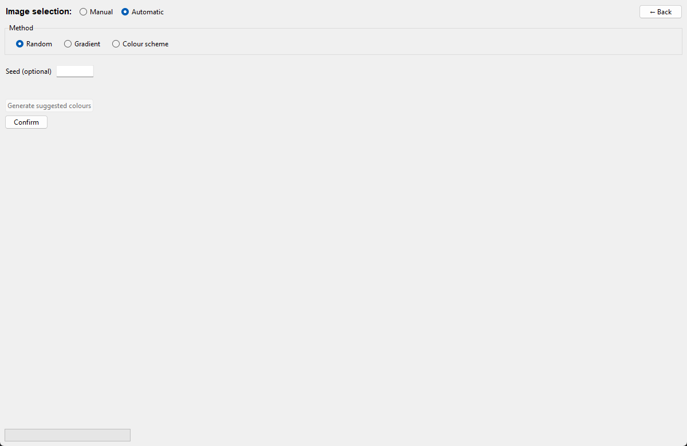

| Method | Use it for | Options |
|---|---|---|
| **Random** | A quick shuffle | **Seed** (optional number): the same seed gives the same result |
| **Gradient** | Images whose dominant colours flow from one colour to another across the template | **Linear** (angle, 0 = left→right, 90 = top→bottom) or **Radial** (centre X%/Y%), start and end colour, **Match threshold (ΔE)** |
| **Colour scheme** | A harmonious palette | **Type** (Any/best fit, Monotone, Analogous, Complementary, Split complementary, Triadic, Tetradic), **Base colour(s)** (+ / − to add), **Hue tolerance °** |

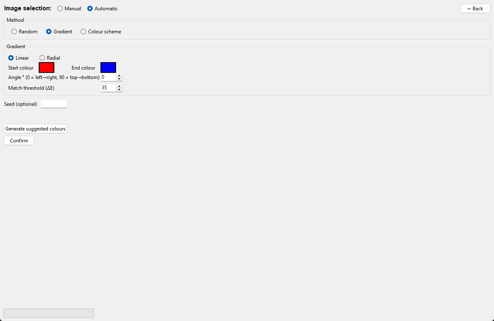

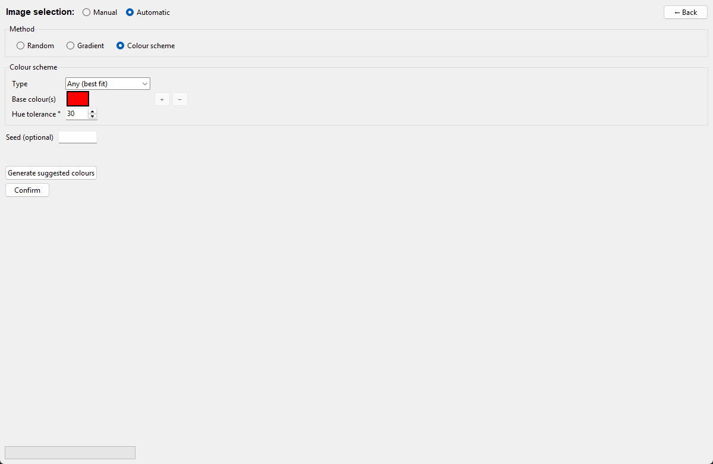

- **Generate suggested colours** analyses your folders and fills in colours that match your image set well. Use it when you are not sure what to pick.
- **Confirm** assigns the images and continues to the crop editor.
- Lower **ΔE** or **Hue tolerance** for a stricter match; raise it to allow more images.
- If nothing fits, the app tells you, applies suggested colours and lets you retry. If it still cannot match it offers the closest matches.
- Colour analysis is cached, so repeating on the same folders is fast.

### Adjust crops

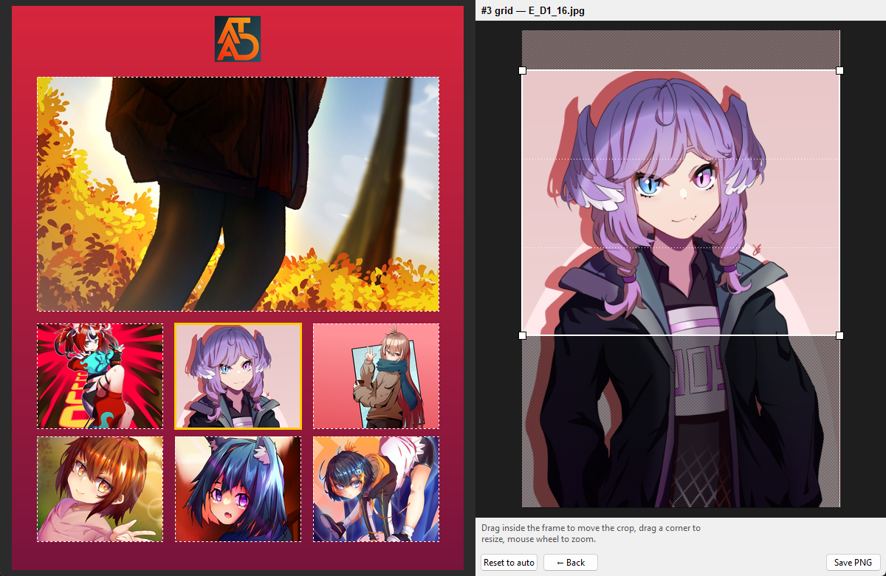

The left side is the live collage preview, the right side is the crop for the selected placeholder.

- **Click a cell** in the preview to select it.
- **Drag inside the frame** to move the crop, **drag a corner** to resize, **mouse wheel** to zoom.
- **Reset to auto** restores the automatic crop for that cell.
- **← Back** returns to image selection.
- **Save PNG** asks where to save (default name `<template>_collage.png`) and warns if the file is larger than about 8 MB, which Instagram may recompress.

Automatic crops use a plain centre-fit when the picture's shape is close to the placeholder's (see **Crop tolerance** in Settings) and a saliency-based crop (it tries to keep the subject) when it is not.

### Instagram size check

When you continue from the folder wizard the app checks the template size against Instagram's formats:

| Preset | Size |
|---|---|
| Square 1:1 | 1080 x 1080 |
| Portrait 4:5 | 1080 x 1350 |
| Landscape 1.91:1 | 1080 x 566 |
| Story/Reel 9:16 | 1080 x 1920 |

If the size is not a preset you are asked: **Yes** = resize the template (and scale its placeholders) to the nearest preset and save it as a new template, **No** = continue anyway, **Cancel** = go back. Control this in Settings under *Non-Instagram template size* (Ask me / Always resize to nearest / Never).

Also, if the template image was replaced by one with a different size, the app offers to scale the placeholders to match.

### Settings

Open **File → Settings...**.

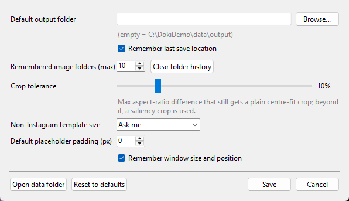

| Setting | What it does |
|---|---|
| **Default output folder** | Where the *Save* dialog starts. Empty uses `%APPDATA%\DokiDokiCollage\output` |
| **Remember last save location** | Start the next save in the folder you used last |
| **Remembered image folders (max)** | Length of the recent-folders list (1 to 50). **Clear folder history** empties it |
| **Crop tolerance** | Largest aspect-ratio difference that still gets a plain centre-fit crop. Beyond it a saliency crop is used. Slider 0% to 50% (default 10%) |
| **Non-Instagram template size** | *Ask me*, *Always resize to nearest*, or *Never (use template size)* |
| **Default placeholder padding (px)** | Initial padding for new placeholders |
| **Remember window size and position** | Reopen where you left it |
| **Open data folder / Reset to defaults** | Shortcuts at the bottom |

### Edit, rename and delete templates

- **Edit:** in the Templates screen, **Edit selected**. Press **Save** in the editor to overwrite, or change **Template name** before saving.
- **Rename:** edit **Template name**, click **Rename** (only for already-saved templates; names must be unique).
- **Delete:** **Delete selected** in the Templates screen. The stored background image is removed with it, unless another template still uses it.
- Moving between screens never loses your work in the editor unless you skip saving; **Continue →** saves first.

---

## Editor cheat sheet

| Action | How |
|---|---|
| Draw a placeholder | Drag on empty space (or Draw mode / Ctrl+drag) |
| Move | Drag the placeholder |
| Resize | Drag one of the 8 handles |
| Exact position / size | Type X, Y, W, H and press Enter |
| Keep aspect ratio | Tick **Lock aspect ratio** (handles and typed values) |
| Select multiple | Shift/Ctrl + click, marquee drag, list multi-select, Ctrl+A |
| Disable snapping | Hold **Alt** while dragging |
| Delete | Delete key or **Delete selected** |
| Change tag | Tag dropdown (applies to the selection) or **New tag...** |
| Split into grid | Select one placeholder, **Split into grid...** |
| Align / distribute | Align panel (3+ items to distribute) |
| Padding | Padding (px) + **Apply** |

---

## Where your data lives

`%APPDATA%\DokiDokiCollage\`

| Path | Contents |
|---|---|
| `templates\` | One JSON per template plus a copy of its background image |
| `settings.json` | Settings and remembered image folders |
| `logs\collage.log` | Errors and diagnostics (**File → Open log**) |
| `output\` | Default save location |

**File → Open data folder** opens it. Old `labelled_templates\` folders next to the app or working directory are imported once on first run.

## Build the .exe

```powershell
.\build.ps1
```

Creates a clean virtualenv, installs the build extras and runs PyInstaller. The result is `dist\DokiDokiCollage\DokiDokiCollage.exe` (one-folder build, no console window). Distribute the whole `DokiDokiCollage` folder.

## Tests

```powershell
python -m pytest
```

## Troubleshooting

| Problem | Fix |
|---|---|
| *Not enough images* when continuing | A tag has more placeholders than images in its folder. Add images or delete placeholders |
| *Missing image folders* | A tag has no folder; go through the folder wizard again |
| Folder shows `[missing]` | It was moved or deleted. Browse for the new location or **Forget selected** |
| *Template image missing* | Click Yes and locate the image again |
| Cannot press *Continue to crop* | Every tab must be exactly full, e.g. `grid (6/6)` |
| Automatic mode says *No matching images* | Raise ΔE / hue tolerance, use **Generate suggested colours**, or accept the closest matches |
| Something odd | Open **File → Open log** and check `collage.log` |

## Repo layout and credits

```
collage/          application package
  ui/             Tk screens: app, editor, selector, cropper, settings, thumbgrid
  assign.py colors.py crop.py saliency.py render.py geometry.py instagram.py ...
tests/            pytest suite
docs/images/      README screenshots
build.ps1, collage.spec, run_collage.py   exe build
```

The screenshots in `docs/images/` were captured from the real app with sample artwork and a demo template.
